# Awesome Mobile App Accessibility Testing 📱♿🧪

  

  
  
  
  
  
  

---

> 🚀 **The definitive curated guide to Mobile App Accessibility Testing.** Explore top-tier cloud enterprise SaaS testing suites and battle-tested open-source libraries for detecting WCAG 2.1 & 2.2 violations, screen reader issues (TalkBack & VoiceOver), color contrast gaps, focus traversal bugs, and touch target size defects across native iOS, Android, Flutter, and React Native applications.
>
> 🌟 *Star this repository to stay up-to-date with emerging mobile a11y tools and audit frameworks!* 🌟

---

## 📑 Table of Contents

- [🌐 Sector Overview & Market Dynamics](#-sector-overview--market-dynamics)
- [🟦 SaaS / Hosted Commercial Platforms](#-saas--hosted-commercial-platforms)
- [🟩 Open-Source Software](#-open-source-software)
  - [1. Google Accessibility Test Framework for Android](#1-google-accessibility-test-framework-for-android)
  - [2. GTXiLib (iOS)](#2-gtxilib-ios)
  - [3. A11yUITests (iOS)](#3-a11yuitests-ios)
  - [4. GSCXScanner (iOS)](#4-gscxscanner-ios)
  - [5. Deque axe-android](#5-deque-axe-android)
  - [6. US Department of Labor Mobile Test Scripts](#6-us-department-of-labor-mobile-test-scripts)
  - [7. In The Pocket Mobile Accessibility Guide & Samples](#7-in-the-pocket-mobile-accessibility-guide--samples)
  - [8. AccessDroid](#8-accessdroid)
  - [9. A11yArgus](#9-a11yargus)
  - [10. Android Accessibility Scanner](#10-android-accessibility-scanner)
- [📊 Feature Comparison at a Glance](#-feature-comparison-at-a-glance)
- [🤝 Contributing](#-contributing)
- [💖 Support & Sponsorship](#-support--sponsorship)
- [📈 Star History](#-star-history)
- [📄 License](#-license)

---

## 🌐 Sector Overview & Market Dynamics

The digital accessibility software and testing market is estimated at **$610M – $930M in 2026** and projected to surpass **$1.6B by 2032** (growing at a compound annual growth rate of ~6% to 9%), with broader accessibility services expanding in double digits driven by statutory deadlines under the **European Accessibility Act (EAA)**, ADA Title II updates, and Section 508 enforcement. The sector remains **moderately fragmented**: while tier-1 automated compliance and test cloud leaders (BrowserStack, Deque Systems, Level Access, and Siteimprove) command roughly 35%–40% aggregate share, high platform diversity across native iOS, Android, and cross-platform stacks leaves abundant room for specialized developer-first mobile SDKs and open-source testing libraries.

---

## 🟦 SaaS / Hosted Commercial Platforms

Commercial cloud-hosted Mobile App Accessibility Testing suites sorted in descending order by parent company scale (valuation / revenue).

| Platform | Company Scale (Valuation / Revenue) | Starting Pricing (Paid Tiers) | Free Tier / Trial Limits | Key Specialization & Capabilities |
|:---|:---|:---|:---|:---|
| **BrowserStack App Accessibility** | **$4.0B Valuation** *(~$230M ARR)* | **$29.00** /user/month *(Standard testing plan; Enterprise accessibility custom quotes)* | **Free Plan available** *(up to 5 pages scanned; 14-day evaluation demo for enterprise accessibility)* | Real-device cloud scanning for iOS and Android; integrated TalkBack and VoiceOver screen readers, App Workflow Scanner, and WCAG 2.1/2.2 audit rule engine. |
| **Siteimprove Mobile Accessibility** | **$911M Valuation** *(~$100M+ ARR)* | **$5,000.00** /year *(Estimated starting modular contract)* | **No free tier** *(Custom scheduled enterprise live demo upon sales request)* | On-device Android testing overlay app leveraging Android Accessibility Services to detect UI elements and WCAG violations live without source code modifications. |
| **Level Access Mobile** | **$100M+ ARR** *(KKR Majority-Backed)* | **$10,000.00** /year *(Starting enterprise platform contract)* | **No free tier** *(Custom guided enterprise demo upon request)* | Native-first testing engine supporting SwiftUI, Jetpack Compose, Flutter, React Native, and MAUI; desktop and cloud SDK integrations with deep framework remediation advice. |
| **Deque axe DevTools Mobile** | **$40M - $100M ARR** *(Private)* | **$60.00** /user/month *(Pro Web; Enterprise mobile driver licenses starting ~$15,000/year)* | **14-day free trial** *(Axe DevTools Pro trial; mobile Appium/Espresso evaluation via demo)* | Dedicated mobile test automation drivers (AxeUiAutomator2, AxeXCUITest) embedded seamlessly into Appium, XCUI, and Espresso CI/CD pipelines. |
| **Evinced Mobile** | **$250M - $500M Valuation** *(Raised $112M)* | **$12,000.00** /year *(Estimated starting team/enterprise license)* | **Free iOS Debugger tool** *(Free standalone iOS accessibility debugger; 14-day trial on web scanner)* | No-SDK Mobile Flow Analyzer requiring zero code modifications or SDK wrapping; detects issues across native views and embedded webviews with automated screen-flow mapping. |
| **AudioEye Mobile Audit** | **$170M Market Cap** *(NASDAQ: AEYE; ~$43M ARR)* | **$49.00** /month *(Automated starter tier; Managed mobile audit quotes from $5,000)* | **14-day free trial** *(Automated web scanner trial; free initial accessibility audit scan)* | Hybrid audit combining automated rule heuristics with certified human manual testers and assistive technology end-users (A11iance community). |

---

## 🟩 Open-Source Software

Curated open-source frameworks, testing harnesses, and research prototypes for mobile accessibility audits, sorted in descending order by GitHub stargazers.

### 1. Google Accessibility Test Framework for Android

- **Repository:** [google/Accessibility-Test-Framework-for-Android](https://github.com/google/Accessibility-Test-Framework-for-Android)
- **Stack:** Java ☕ • Android • Espresso • Robolectric
- **License:** Apache-2.0
- **Supported Platforms:** Android 🤖
- **Why It Stands Out:**
  - Google's official, foundational accessibility engine that powers Android Studio's Layout Inspector and Accessibility Scanner.
  - Inspects `View` and `AccessibilityNodeInfo` objects for missing content descriptions, touch target bounds (minimum 48×48dp), and color contrast deficiencies.
  - Direct, one-line integration into Espresso UI suites (`AccessibilityChecks.enable()`) for automated continuous regression tests.

### 2. GTXiLib (iOS)

- **Repository:** [google/GTXiLib](https://github.com/google/GTXiLib)
- **Stack:** Objective-C 🍏 • Swift • CocoaPods • XCTest
- **License:** Apache-2.0
- **Supported Platforms:** iOS 🍎
- **Why It Stands Out:**
  - Google Toolbox for Accessibility for iOS: runs automated accessibility checks directly within standard `XCTest` and EarlGrey test suites.
  - Zero-friction integration via `+setUp` allowing existing functional test suites to double as continuous accessibility validation checks.
  - Extensible check block system allowing teams to register custom enterprise rules (e.g., verifying accessibility elements avoid raw image file extensions).

### 3. A11yUITests (iOS)

- **Repository:** [rwapp/A11yUITests](https://github.com/rwapp/A11yUITests)
- **Stack:** Swift 🦅 • XCUITest • iOS
- **License:** MIT
- **Supported Platforms:** iOS 🍎
- **Why It Stands Out:**
  - Native Swift testing extension designed specifically for Apple's `XCUITest` automation framework.
  - Verifies interactive target dimensions against WCAG 2.1 Success Criteria 2.5.5 / 2.5.8 (target sizing standards).
  - Validates accessibility element labeling, trait conflicts, and screen element reachability with clean assertions.

### 4. GSCXScanner (iOS)

- **Repository:** [google/GSCXScanner](https://github.com/google/GSCXScanner)
- **Stack:** Objective-C 🍏 • GTXiLib • iOS
- **License:** Apache-2.0
- **Supported Platforms:** iOS 🍎
- **Why It Stands Out:**
  - Interactive on-device developer assistant from Google that injects a floating "Perform Scan" trigger button into debug builds.
  - Evaluates live screen view hierarchies using GTXiLib check rules without requiring automated test script writing.
  - Allows engineers and designers to catch accessibility regressions during ad-hoc manual testing sessions before staging release.

### 5. Deque axe-android

- **Repository:** [dequelabs/axe-android](https://github.com/dequelabs/axe-android)
- **Stack:** Java ☕ • Android SDK • WCAG
- **License:** LGPL-3.0
- **Supported Platforms:** Android 🤖
- **Why It Stands Out:**
  - Deque Systems' open-source Java accessibility library that laid the algorithmic foundation for automated mobile WCAG rule scanning.
  - Evaluates native Android layout trees for programmatic focus traversal, missing accessible descriptions, and text scaling compliance.
  - Serves as an open reference implementation for integrating accessibility checks into Gradle test pipelines.

### 6. US Department of Labor Mobile Test Scripts

- **Repository:** [USDepartmentofLabor/Mobile-Accessibility-Test-Script](https://github.com/USDepartmentofLabor/Mobile-Accessibility-Test-Script)
- **Stack:** Markdown 📝 • Section 508 Guidelines • iOS / Android
- **License:** Public Domain (US Federal Government)
- **Supported Platforms:** iOS 🍎 • Android 🤖
- **Why It Stands Out:**
  - Official test scripts and repeatable operational procedures for validating native mobile applications against Section 508 standards.
  - Provides structured test cases for VoiceOver, TalkBack, display zoom, high contrast, and keyboard navigation.
  - Indispensable benchmark for public sector vendors and enterprise QA teams preparing compliance VPAT documentation.

### 7. In The Pocket Mobile Accessibility Guide & Samples

- **Repository:** [inthepocket/mobile-accessibility](https://github.com/inthepocket/mobile-accessibility)
- **Stack:** Kotlin 🤖 • Swift 🍏 • Jetpack Compose • SwiftUI
- **License:** MIT
- **Supported Platforms:** iOS 🍎 • Android 🤖
- **Why It Stands Out:**
  - Comprehensive reference application demonstrating common mobile accessibility antipatterns and their corrected implementations.
  - Features side-by-side examples in Jetpack Compose and SwiftUI for custom accessibility actions, announcement queues, and touch targets.
  - Ideal companion tool for engineering teams establishing mobile accessibility design systems and automated UI audits.

### 8. AccessDroid

- **Repository:** [wsong-nj/AccessDroid](https://github.com/wsong-nj/AccessDroid)
- **Stack:** Python 🐍 • Android • Semantics Trees • ADB
- **License:** Open Source (GPL-3.0 / Zenodo)
- **Supported Platforms:** Android 🤖
- **Why It Stands Out:**
  - Analyzes the runtime Android accessibility semantics tree rather than raw UI layouts to detect subtle screen reader failures.
  - Categorizes defects across semantics separation, semantics downshift, and semantics omission with **98.8% precision and 98.3% recall**.
  - Renders red bounding box overlays on live device screens and generates plain-text audit summaries in ~15ms per page.

### 9. A11yArgus
- **Repository / Archive:** [A11yArgus Replication Package (Figshare / ACM)](https://figshare.com/articles/software/_/28163012)
- **Stack:** Python 🐍 • DroidBot • UI Automator • OCR
- **License:** Research Prototype (ACM)
- **Supported Platforms:** Android 🤖
- **Why It Stands Out:**
  - Hybrid academic analyzer combining structural UI hierarchy parsing, layout geometric reasoning, and OCR image validation.
  - Detects 13 accessibility violation types, including novel classifications like gesture-only navigation and overlapping elements.
  - Verified across 200 real-world applications with 91.9% precision and 97.8% recall across WCAG 2.1/2.2 principles.

### 10. Android Accessibility Scanner
- **Distribution:** [Google Play Store](https://play.google.com/store/apps/details?id=com.google.android.apps.accessibility.auditor)
- **Stack:** Android Native 🤖 (Google)
- **License:** Freeware (Google)
- **Supported Platforms:** Android 🤖
- **Why It Stands Out:**
  - Official Google on-device accessibility utility for immediate interactive scanning without developer workstations or ADB setup.
  - Provides instant visual badges flagging touch target sizes (<48dp), low contrast ratios, and unlabeled UI components.
  - Universally adopted as a baseline audit standard in both industry QA cycles and academic research benchmarks.

---

## 📊 Feature Comparison at a Glance

| Software | License / Model | Target Platforms | Primary Stack | Real Device / Cloud | Screen Reader Analysis | Automated CI/CD | WCAG 2.1/2.2 | Ideal Use Case |
|:---|:---|:---:|:---|:---:|:---:|:---:|:---:|:---|
| **BrowserStack App Accessibility** | Commercial SaaS | iOS + Android | Cloud Device Farm | ✅ | ✅ *(TalkBack & VoiceOver)* | ✅ | ✅ | Enterprise teams wanting zero-setup physical cloud testing |
| **Siteimprove Mobile** | Commercial SaaS | Android | Android Service App | ✅ | ❌ | ⚠️ | ✅ | QA teams needing live on-device overlay audits |
| **Level Access Mobile** | Commercial SaaS | iOS + Android | Multi-Engine / Cloud | ✅ | ❌ | ✅ | ✅ | Multi-framework native apps (Flutter, Compose, SwiftUI) |
| **Deque axe DevTools Mobile** | Commercial SaaS | iOS + Android | Appium / Native Drivers | ✅ | ❌ | ✅ *(Deep Appium)* | ✅ | Teams with existing Appium or Espresso test infrastructure |
| **Evinced Mobile** | Commercial SaaS | iOS + Android | No-SDK Flow Analyzer | ✅ | ⚠️ *(Flow heuristics)* | ✅ | ✅ | Organizations needing automated audits without SDK code changes |
| **AudioEye Mobile Audit** | Commercial SaaS / Audit | iOS + Android | Hybrid Platform + Human | ✅ | ✅ *(Human Assistive Users)* | ⚠️ | ✅ | High-liability applications requiring human-certified VPAT audits |
| **Google ATF for Android** | Open Source (Apache-2) | Android | Java / Espresso | ✅ | ⚠️ *(Node info)* | ✅ *(Espresso/Robolectric)* | ✅ | Android teams wanting automated compile-time UI regression checks |
| **GTXiLib** | Open Source (Apache-2) | iOS | Obj-C / Swift / XCTest | ✅ | ⚠️ *(Label checks)* | ✅ *(XCTest)* | ✅ | iOS teams automating accessibility assertions in XCTest suites |
| **A11yUITests** | Open Source (MIT) | iOS | Swift / XCUITest | ✅ | ❌ | ✅ *(XCUITest)* | ✅ | Apple developers validating target dimensions and trait states |
| **GSCXScanner** | Open Source (Apache-2) | iOS | Obj-C / GTXiLib | ✅ | ❌ | ❌ *(In-app manual)* | ✅ | Developers catching accessibility bugs during interactive testing |
| **Deque axe-android** | Open Source (LGPL-3) | Android | Java / Android | ✅ | ❌ | ✅ *(Gradle)* | ✅ | Custom Android build pipelines using open WCAG rules |
| **US Dept of Labor Scripts** | Public Domain | iOS + Android | Test Case Procedures | ✅ | ✅ *(TalkBack/VoiceOver)* | ❌ *(Manual)* | ✅ | Public sector compliance and manual Section 508 VPAT verification |
| **In The Pocket Samples** | Open Source (MIT) | iOS + Android | SwiftUI / Jetpack Compose | ✅ | ✅ *(Sample implementations)*| ⚠️ | ✅ | Developers learning and implementing accessible mobile components |
| **AccessDroid** | Open Source (GPL-3) | Android | Python / ADB Semantics | ✅ | ✅ *(Semantics tree)* | ⚠️ *(ADB Scripts)* | ✅ | Deep screen reader semantics tree auditing on Android |
| **A11yArgus** | Research Prototype | Android | Python / DroidBot / OCR | ✅ | ⚠️ | ⚠️ | ✅ | Advanced research on geometric and OCR-based mobile a11y gaps |
| **Android Accessibility Scanner**| Freeware (Google) | Android | Android App | ✅ | ❌ | ❌ *(Manual trigger)* | ✅ | Rapid on-device accessibility sanity checks without coding |

---

## 🤝 Contributing

Contributions, additional open-source tools, and documentation improvements are welcome!

1. Fork the repository.
2. Create your feature branch (`git checkout -b feature/AddA11yTool`).
3. Commit your changes (`git commit -m "Add new mobile accessibility testing tool"`).
4. Push to the branch (`git push origin feature/AddA11yTool`).
5. Open a Pull Request.

Please ensure submitted tools are actively maintained, include clear licensing, and specifically target mobile application accessibility.

---

## 💖 Support & Sponsorship

If this curated repository saved you research time or assisted in choosing the right mobile accessibility testing solution for your team, please consider supporting the project:

- ⭐ **Star this repository** to help others discover it.
- 🍴 **Fork and contribute** your own insights, tools, or audit frameworks.
- 📢 **Share with fellow mobile engineers, QA testers, and accessibility advocates.**
- ☕ **Buy me a coffee / Sponsor:** Support ongoing maintenance via the [GitHub Sponsors Dashboard](https://github.com/sponsors/ishandutta2007).

---

##  Star History

---

## 📄 License

This repository and curated compilation are released under the [Creative Commons Zero v1.0 Universal](https://creativecommons.org/publicdomain/zero/1.0/) (CC0 1.0 - Public Domain Dedication). All referenced software, trademarks, and logos belong to their respective copyright holders.
